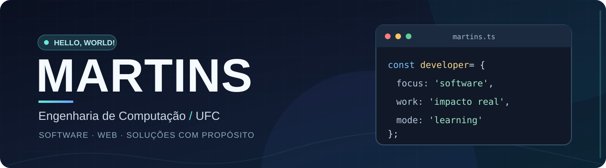

 

  <h2>Olá, eu sou o Martins! 👋</h2>
  

    🎓 Estudante de <strong>Engenharia de Computação</strong> na <strong>Universidade Federal do Ceará (UFC) — Campus Sobral</strong>. 
    💡 Gosto de transformar necessidades reais em soluções tecnológicas úteis.
  

  

  

  

---

### 👨‍💻 Sobre mim

- 🏛️ Faço parte da equipe de desenvolvimento do **SisEU**, sistema de gerenciamento dos Encontros Universitários da UFC — Campus Sobral.
- 🚀 Idealizei o **GerCon**, projeto pessoal pensado para facilitar a gestão de escalas e outras demandas de grupos de coroinhas.
- 🎨 Também participei do **InclusivaMente Matemática**, uma experiência educacional interativa em 3D.
- 🌱 Busco aprender continuamente sobre **desenvolvimento web, APIs, bancos de dados e engenharia de software**.

### 🚀 Projetos em destaque

<table>
  <tr>
    <td width="50%" valign="top">
      <h3>🎓 SisEU</h3>
      
<strong>Sistema dos Encontros Universitários</strong>

      
Plataforma institucional da UFC — Campus Sobral, desenvolvida em equipe para apoiar a organização do evento, a avaliação de trabalhos acadêmicos e a gestão das apresentações.

      
<strong>Minha participação:</strong> desenvolvimento colaborativo, com contribuições em funcionalidades ligadas à alocação de apresentações.

      
<code>React</code> <code>TypeScript</code> <code>NestJS</code> <code>Prisma</code> <code>PostgreSQL</code>

      Projeto em equipe · repositório de acesso restrito
    </td>
    <td width="50%" valign="top">
      <h3>⛪ GerCon</h3>
      
<strong>Gestão de coroinhas</strong>

      
Projeto pessoal idealizado para organizar escalas de serviço, integrantes e demandas de um grupo de coroinhas, aproximando tecnologia e serviço à comunidade.

      
<strong>Meu papel:</strong> idealização e planejamento da solução, a partir de necessidades observadas no cotidiano.

      
<code>Projeto autoral</code> <code>Gestão</code> <code>Comunidade</code>

      Projeto pessoal · link público a adicionar
    </td>
  </tr>
</table>

#### 🧮 InclusivaMente Matemática

Aplicação educacional com **ambiente 3D interativo**, desenvolvida em equipe para apoiar o ensino de matemática básica a estudantes neurodivergentes. Minha contribuição foi no **módulo de soma e subtração**.

`JavaScript` · `Three.js` · `WebGL` · `Vite`

🔗 [Código-fonte](https://github.com/Snitram12/inclusivamente-matematica) · [Experimentar a aplicação](https://inclusivamente-matematica.vercel.app/)

### 🧰 Tecnologias presentes nos meus projetos

  
  
  
  
  
  
  
  
  
  

### 🧭 O que me motiva

Acredito que bons projetos de software começam com uma pergunta simples: **qual problema vale a pena resolver?**

Seja na universidade ou em iniciativas pessoais, procuro criar soluções que unam **aprendizado técnico, organização e impacto positivo**.

---

  Obrigado pela visita! 👋 Explore os projetos e acompanhe minha evolução como desenvolvedor.

